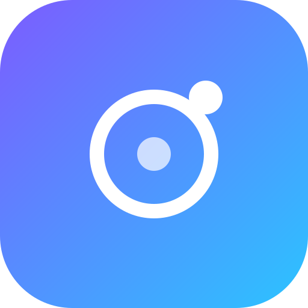

<p align="center"></p>

# Aeris Launcher

Launcher Android bertema iOS: Pustaka Aplikasi, dock kaca, widget cuaca & foto, Pusat Kontrol, dan pop up volume vertikal.
Dibuat dengan **Kotlin + Jetpack Compose**. Minimal **Android 8.0 (API 26)**.

## Fitur

- **Layar utama** dengan halaman-halaman ikon, widget cuaca (Open-Meteo, tanpa API key) dan widget foto
- **Pustaka Aplikasi** ala iOS: aplikasi dikelompokkan otomatis (Sosial, Hiburan, Utilitas, Belanja & Uang, Game, Lainnya)
- **Dock** 4 aplikasi + tombol kecil **Cari** di atasnya (ketuk = cari, tahan = pengaturan)
- **Mode tampilan**: Normal, Liquid Glass, Gelap
- **Ikon custom**: tahan ikon → *Ganti ikon…* → pilih foto/gambar sendiri; ukuran dan bentuk ikon bisa diubah
- **Status bar ala iOS**: jam, sinyal, Wi-Fi, baterai yang simpel dan modern
- **Pusat Kontrol**: ketuk status bar atau geser ke bawah dari atas layar (tile Wi-Fi/Data/Bluetooth/Senter + slider volume vertikal)
- **Pop up volume vertikal** di sisi kanan, bisa digeser dengan jari

## Cara build

**Android Studio (disarankan)**
1. Buka folder proyek ini (`File → Open`), tunggu Gradle sync.
2. Colok HP (USB debugging aktif) lalu klik **Run**.
3. Tekan tombol Home → pilih **Aeris** → **Selalu**.

**Lewat GitHub Actions**: setiap `push` ke `main` otomatis membangun APK. Unduh dari tab *Actions* → run terbaru → *Artifacts* → `aeris-launcher-debug-apk`.

## Batasan yang perlu diketahui

- Status bar iOS dan pop up volume hanya tampil **di dalam launcher**. Android tidak mengizinkan launcher biasa menggantinya di dalam aplikasi lain.
- Panel notifikasi bawaan Android tetap dipakai (Aeris tidak menggantinya).
- Ikon custom tersimpan di penyimpanan internal aplikasi; hilang bila data aplikasi dihapus.

## Struktur

```
app/src/main/java/com/aeris/launcher/
  MainActivity.kt, LauncherViewModel.kt
  data/    model, pengaturan, ikon, cuaca
  system/  status sistem (baterai, jaringan), senter
  ui/      layar utama, dock, library, kontrol, volume, pengaturan
```

## Lisensi

MIT
